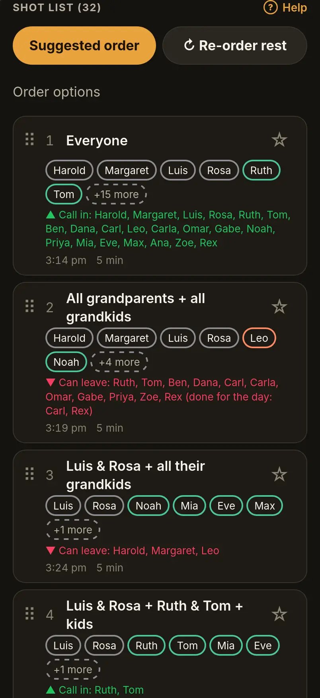
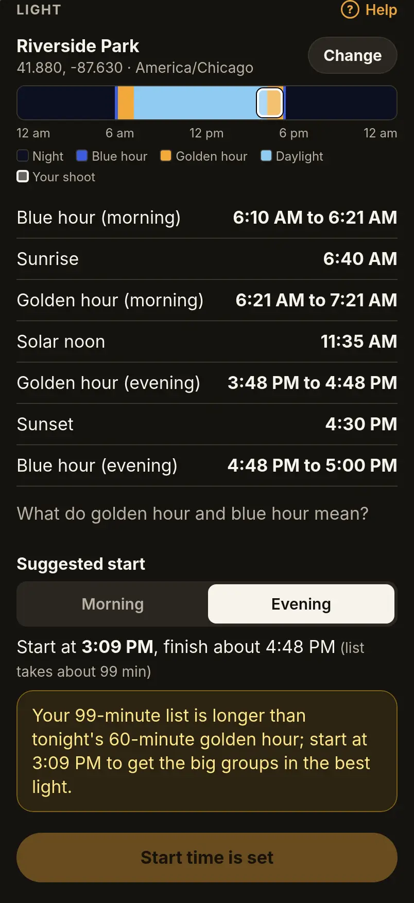
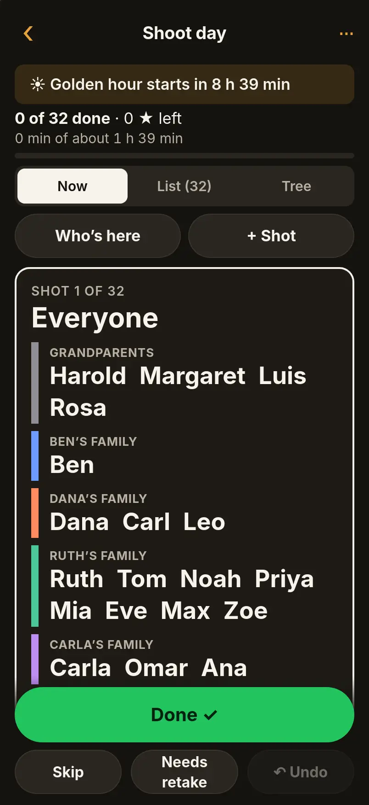
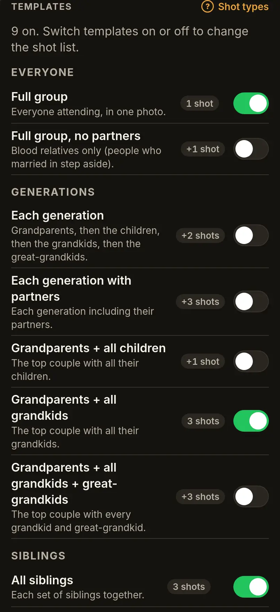
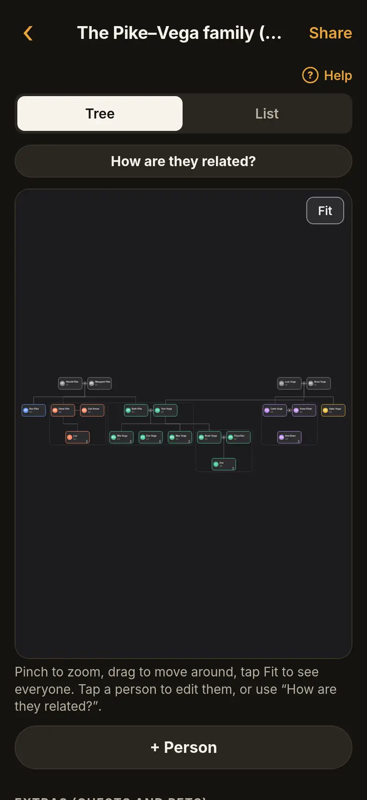

# Photo Planner

**Plan every family photo before the shoot, and tick them off on the day.**

Photo Planner is an iPhone app for family and group photographers. Describe a family once (who is married to whom, who is whose child) and it builds the shot list: the full group, each generation, each household, grandparents with each family, all the cousins, solo portraits and more. On the day, an assistant holds the phone, calls out who is in the next shot, and taps **Done**. Nothing is forgotten.

- Works with no internet once installed. Everything is stored on your phone.
- Free: no App Store, no account, no tracking.

App: **https://mattbat.com/photo-planner/** (the address may change if the app is renamed).

<p>
  
  
  
</p>

> **Status: version 0.1, heading for 1.0.** Families and the tree, the shot engine, shoot day, golden hour, the pose library and an in-app guide are built. The assistant hand-off is arriving next; see [docs/STATUS.md](docs/STATUS.md).

---

## For photographers

### Install it on your iPhone

1. Open **https://mattbat.com/photo-planner/** in **Safari**. Other browsers on iPhone can't install apps.
2. Tap the **Share** button (the square with an arrow pointing up).
3. Scroll down and tap **Add to Home Screen**, then **Add**.
4. Open Photo Planner from the new icon on your Home Screen.

It opens full screen like any other app and works with no signal.

### Help in the app

The first time it opens, a short intro shows what Photo Planner does (tap **Skip** to go straight in) and ends with **Try the demo family** or **Add my own family**. After that, **Settings → Help and guide** has a full guide with pictures. Screens with something to explain have a **?** link to the right page, and **ⓘ** buttons explain options in a line. **Help → Replay the intro** shows the intro again.

### Quick start

1. **Add a family** (Families tab). **Quick add family** takes a list of names, **New family** starts empty, **Load demo family** adds a made-up one to look around. Say who is married to whom and whose child each person is. The tree draws itself, and **How are they related?** answers "who is Zoe to Ben?".
2. **Plan a shoot** (Shoots tab, **+ New shoot**): choose the family and date, and tick who is coming.
3. **Choose the shots.** Switch on templates (everyone, each generation, each household, cousins, solo portraits, grown children and more); each shows how many shots it makes. Add custom shots, star must-haves, remove and restore. **Suggested order** puts kids first, releases older guests early and shoots big groups while everyone is fresh. Every shot shows who to call in and who can leave.

<p>
  
  
</p>

### Golden hour

Set a place (your position, a searched address, coordinates or a pin on a map) and the shoot shows sunrise, golden and blue hour, sunset and the sun's direction. **Suggested start** says when to begin so the list ends as evening golden hour ends, and warns if the list is too long. **Pick a date** compares the next three weeks, and the weather forecast shows for the next 14 days. The map, search and forecast need a connection; the sun times don't.

### Shoot day

Tap **Start shoot**. The screen stays awake. The big **Done** moves to the next shot; **Skip**, **Needs retake** and **Undo** sit beside it. **Who's here** marks people arrived or gone: shots that need someone who isn't here wait, and come back when they arrive. **+ Shot** adds a photo on the spot. **Finish shoot** gives a summary to share.

### Poses

The Poses tab is a library of simple illustrated poses by category and group size. Favorite them, add your own, and pick suggested poses for a shot so they show on shoot day.

### Assistant hand-off

An assistant can run the checklist on their own phone. Hand the shoot over by link or AirDrop file. One phone runs the checklist at a time (**Take back control** if needed), and it is sent back at the end so your copy has every tick. See **Working with an assistant** in the in-app guide.

### Your data and backups

Everything is stored only on your phone: no account, no tracking. **Settings → Back up everything** saves a file (to Files, iCloud Drive or by AirDrop). **Restore** puts it back on any phone, either merging with what is there or replacing everything. Back up before deleting the app or clearing Safari's website data.

### Updates

Updates are never applied without asking: you'll see "A new version is ready" and can update when it suits you. **Settings → What's new** lists the changes in each version, and **Diagnostics** shows what your phone reports, for troubleshooting. **Appearance** is Match phone (the default), Light or Dark.

---

## For developers

React 19 + TypeScript + Vite, `vite-plugin-pwa`, Dexie (IndexedDB), Leaflet (map picker), Vitest (+ fast-check, Testing Library, fake-indexeddb), Playwright, sharp (screenshots), ESLint. Built like [next5](https://github.com/mattbat/next5). The spec is [REQUIREMENTS.md](REQUIREMENTS.md); the rules for contributors are in [CLAUDE.md](CLAUDE.md).

```
npm install
npm run dev          # http://localhost:5173/photo-planner/
npm run check        # lint, types, unit tests + coverage, build, e2e (run before every commit)
npm run icons        # regenerate PNG icons from public/favicon.svg
npm run release      # what's waiting to be released; `-- minor` makes a release
npm run screenshots  # retake the help screenshots in public/help/ (builds first)
```

Node 22 or newer. End-to-end tests need browsers: `npx playwright install --with-deps webkit chromium`. `SHOTS_OUT=<folder>` saves the screenshots there as PNGs instead; `SHOTS_W`/`SHOTS_H` change the size and `SHOTS_ALL=<folder>` also saves every main screen, for a visual check.

### Layout

| Folder | What lives there |
|--------|------------------|
| `src/engine` | Pure: shot generation and ordering |
| `src/tree` | Pure: family-tree layout |
| `src/sun` | Pure: sun position and golden hour |
| `src/domain` | Pure: other helpers (adapters, dates, shoot-day rules) |
| `src/data` | Types, Dexie schema, `repo.ts` (the only writer), backup, validation |
| `src/screens`, `src/components`, `src/hooks` | The UI |
| `src/help` | The in-app guide: topics (`topics.tsx`), screenshot list (`shots.ts`), intro state |
| `scripts/screens` | Takes the help screenshots (`npm run screenshots`) |
| `public/help` | Help screenshots, `<name>-dark.webp` and `<name>-light.webp`, precached for offline |

### Data

Dexie database `photo-planner`: `families`, `people`, `partnerships`, `extras`, `shoots` (each shoot embeds its shot list), `poses`, `posePhotos`, `locations`, `settings`. A person's parents are stored on the person (`parentIds`); partnerships are their own records because they have a status. Types and the reasoning are in `src/data/types.ts`. Never edit an existing `version(n)`; add a new one with a migration.

### How it works

- **Shot engine** (`src/engine`, pure). `generate.ts` takes the people, partnerships, extras, the enabled templates (29 ids in `templates.ts`, the single source of truth) and who is attending, and returns shots. Each template yields candidate groups; identical groups are merged and keep every template that wanted them, so switching templates never duplicates a photo. Previews count what a template would add before it is on. Removed shots are remembered by a stable key so they stay removed.
- **Order** (`order.ts`). Arranges the list from the order options (kids first, release older people early, big group first, must-haves early), and works out call-in and can-leave lists and the time estimate. Shots moved by hand are kept in place by **Re-order rest**.
- **Tree layout** (`src/tree`, pure). Generations become rows, couples sit together, children are centered under their parents and each branch gets a color. `FamilyTree` draws it as SVG with pan and zoom, and the same layout is exported as a PNG.
- **Sun** (`src/sun`, pure). Solar position (elevation and compass bearing) from the NOAA algorithm. Golden hour (+6° to -4°), blue hour (-4° to -6°), sunrise, sunset and noon are found by searching the day in the location's time zone, and `plan.ts` picks the suggested start from the list's duration.
- **Help**. Each topic in `src/help/topics.tsx` is plain JSX that names screenshots from `shots.ts`. `Help.test.tsx` checks every topic renders and every screenshot exists. After changing a screen, run `npm run screenshots` and commit the images.

### Tests

Unit tests for pure code run in Node, screen tests in jsdom (see `test.projects` in `vite.config.ts`). Coverage must stay at 90% overall and 95% for `src/engine`, `src/tree`, `src/sun` and `src/domain`. End-to-end tests (`e2e/`) run in WebKit at iPhone 17 size (402×874), plus an offline-launch test in Chromium; they start past the first-run intro (`photo-planner.introSeen` in `playwright.config.ts`), and `e2e/help.spec.ts` tests it from a fresh phone. Use made-up names only: the repo is public.

### Releases and deploy

Merging is not releasing. Every pull request adds a note in `changes/`. `npm run release -- <patch|minor|major>` moves the notes into `CHANGELOG.md` and `src/changelog.json` and bumps the version, in a pull request of its own. CI deploys to GitHub Pages (https://mattbat.com/photo-planner/) only when a push to `main` raises the version, and then tags a GitHub release. Branches build as **beta** previews on Cloudflare Pages (`CF_PAGES=1`): own name, own data, "Coming next" notes in Settings.
